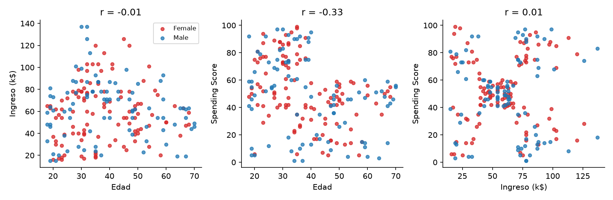

# TP Segmentación de clientes (Mall Customers): Resumen de Analisis basado en el Analisis detallado 
Datos: 200 clientes, 4 variables (género, edad, ingreso anual en k$, Spending Score 1-100). Sin faltantes ni duplicados. Semilla 42. El desarrollo completo está en [Analisis detallado de Segmentacion de Clientes Mall.md](outputs/Analisis%20detallado%20de%20Segmentacion%20de%20Clientes%20Mall.md).

## 1. Exploración: qué variables ayudan a segmentar y por qué

| Variable | Veredicto | Evidencia |
|---|---|---|
| **Ingreso anual** | **Usar** | Es independiente del score (r = 0.01), así que aporta una dimensión distinta. |
| **Spending Score** | **Usar** | Es la medida de conducta de compra. Sumada al ingreso forma bloques bien separados. |
| **Edad** | **Usar para describir**, no para agrupar | Se asocia con el score (r = -0.33, p < 0.001), pero agregarla empeora la separación (silueta 0.43 contra 0.55). |
| **Género** | **No usar** | Sin diferencias en edad, ingreso ni score (p > 0.4), y sin asociación con los segmentos (p = 0.69). |

Ingreso y score solos ya muestran 5 nubes en el gráfico de dispersión (panel derecho de la figura).

## 2. Clustering: método y cantidad de grupos

**K-means con k = 5** sobre ingreso y score estandarizados. Criterios sobre k = 2 a 10:

| Criterio | Resultado |
|---|---|
| Codo (inercia) | La última caída grande (40%) ocurre al pasar a k = 5. Después baja solo 16%. |
| Silueta | Máxima en k = 5 (0.555). |
| Davies-Bouldin | Mínimo en k = 5 (0.572). |
| Calinski-Harabasz | Salto fuerte hasta k = 5 y después casi plano. |
| BIC (mezcla gaussiana) | Mínimo en k = 5. |
| Gap statistic | **No concluyente**: la regla estándar elige k = 1. Su salto más grande sí está en k = 5. |

Estabilidad: con remuestreos del 80% de los clientes, la coincidencia con el modelo final (ARI) es 0.99. Ward y mezcla gaussiana coinciden con K-means (ARI 0.94 y 0.96).

## 3. Segmentos y acción de marketing

| Seg. | Clientes | Perfil en una frase | Edad / Ingreso / Score (medias) | Acción de marketing |
|---|---|---|---|---|
| 0 | 22 (11%) | **Jóvenes gastadores con ingreso bajo**: compran mucho con poco dinero. | 25 / 26k / 79 | Cuotas sin interés, cupones de monto bajo y promociones en redes sociales para jóvenes. Meta: mantener la frecuencia sin empujar sobreendeudamiento. |
| 1 | 23 (11.5%) | **Ahorradores con ingreso bajo**: poco dinero y poco gasto. | 45 / 26k / 21 | No invertir en descuentos masivos. Mails de bajo costo con ofertas de primera necesidad y un cupón de prueba para medir respuesta. |
| 2 | 81 (40.5%) | **El cliente medio**: ingreso y gasto moderados, el núcleo del centro. | 43 / 55k / 50 | Programa de puntos y ofertas de temporada. Campaña "sumá un nivel" para subir el ticket. |
| 3 | 39 (19.5%) | **Premium**: ingreso alto y gasto alto, el cliente ideal. | 33 / 87k / 82 | Membresía VIP con acceso anticipado a lanzamientos, personal shopper y eventos privados. Prioridad en retención. |
| 4 | 35 (17.5%) | **Potencial dormido**: ingreso alto pero gasto bajo. | 41 / 88k / 17 | Reactivación: encuesta corta para entender por qué no compran, y curaduría de marcas premium y experiencias. Probar con grupo de control. |

## 4. Auditoría: ¿qué criterio usó la IA para decidir que los grupos tienen sentido? ¿Está de acuerdo?

**Criterios aplicados:**
1. **Separación estadística:** silueta 0.555, Davies-Bouldin mínimo, BIC mínimo, todos en k = 5.
2. **Estabilidad:** ARI de 0.99 en remuestreos, y 0.94 a 0.96 contra otros dos métodos.
3. **Interpretabilidad:** cada centroide se traduce a una acción distinta.
4. **Tamaño:** ningún grupo bajo 11% de los clientes.

**Verificación independiente:** la IA (Claude) reimplementó K-means y la silueta a mano. Las inercias coinciden (65.57) y las siluetas también (0.5547 contra 0.5547).

**Valoración de lo que la IA (Claude) encontro** :
- **De acuerdo** con k = 5 como segmentación útil: lo respaldan casi todos los criterios y los grupos son accionables. Las graficas de inercia y Silueta muestran que el Ka mas adecuado es 5 aunque solo por el grafico de Inercia me hubiera inclinado por un grupo mas, k = 6 
				
- Los grupos salen tan limpios porque el dataset es didáctico. Con datos reales de un cliente, una silueta de 0.55 sería inusualmente alta
- k = 6 es casi igual de bueno (silueta 0.540, ARI 0.96 contra k = 5); la elección entre 5 y 6 no es tajante.
- La gap statistic no apoyó ningún k, y el codo es en parte subjetivo.
- "Spending Score" es un índice ya calculado, no compras observadas. Inferir conducta de compra a partir de él es parcial.
- Las acciones son hipótesis: hay que validarlas con una prueba A/B antes de invertir.
- **Corrección detectada en la verificación:** con una sola corrida de K-means (n_init = 1), solo el 57.5% de las 200 semillas llega a la solución final. La IA (Claude) usó 100 inicios para evitar mínimos locales.

---
