# Análisis completo: segmentación de clientes (Mall Customers)

Documento de desarrollo del TP. Las respuestas resumidas están en [Respuestas_concretas_TP_Segmentacion.md](Respuestas_concretas_TP_Segmentacion.md).

**Reproducibilidad:** todo se genera con [scripts/01_analisis_segmentacion.py](../scripts/01_analisis_segmentacion.py) (Python 3.13, scikit-learn, scipy, pandas). Semilla global 42. Las figuras están en `outputs/figuras/` y las tablas en `outputs/tablas/`.

## Índice
1. [Resumen ejecutivo](#1-resumen-ejecutivo)
2. [Datos y calidad](#2-datos-y-calidad)
3. [Exploración: qué variables segmentan](#3-exploración-qué-variables-segmentan)
4. [Elección del número de grupos](#4-elección-del-número-de-grupos)
5. [Modelo final y segmentos](#5-modelo-final-y-segmentos)
6. [Acciones de marketing](#6-acciones-de-marketing)
7. [Variante con edad (tres variables)](#7-variante-con-edad-tres-variables)
8. [Verificación independiente](#8-verificación-independiente)
9. [Auditoría de criterios](#9-auditoría-de-criterios)
10. [Limitaciones y próximos pasos](#10-limitaciones-y-próximos-pasos)

---

## 1. Resumen ejecutivo

- Los 200 clientes se agrupan en **5 segmentos** con K-means sobre **ingreso anual y Spending Score** estandarizados.
- k = 5 es el óptimo según silueta, Davies-Bouldin y BIC. El codo marca la última caída grande en k = 5. La gap statistic no fue concluyente.
- La solución es estable (ARI 0.99 en remuestreos) y la reproducen otros dos métodos (Ward y mezcla gaussiana).
- La edad no entra al agrupamiento pero **sí diferencia a los segmentos** (Kruskal-Wallis p < 0.001). El género no aporta.

| Seg. | Nombre | Clientes | Ingreso | Score | Edad |
|---|---|---|---|---|---|
| 0 | Jóvenes gastadores con ingreso bajo | 22 | bajo | alto | joven |
| 1 | Ahorradores con ingreso bajo | 23 | bajo | bajo | mayor |
| 2 | Cliente medio | 81 | medio | medio | mixta |
| 3 | Premium | 39 | alto | alto | 27-40 |
| 4 | Potencial dormido | 35 | alto | bajo | mixta |

---

## 2. Datos y calidad

Archivo: [fuentes/Mall_Customers.csv](../fuentes/Mall_Customers.csv).

| Control | Resultado |
|---|---|
| Filas | 200 |
| Columnas | 5 (CustomerID, Gender, Age, Annual Income (k$), Spending Score (1-100)) |
| Valores faltantes | 0 |
| Filas duplicadas (con o sin ID) | 0 |
| Género | 112 mujeres (56%), 88 hombres (44%) |

### Estadísticos descriptivos ([tabla](tablas/01_descriptivos.csv))

| | Edad | Ingreso (k$) | Score |
|---|---|---|---|
| Media | 38.85 | 60.56 | 50.20 |
| Desvío | 13.97 | 26.26 | 25.82 |
| Mínimo | 18 | 15 | 1 |
| Mediana | 36 | 61.5 | 50 |
| Máximo | 70 | 137 | 99 |

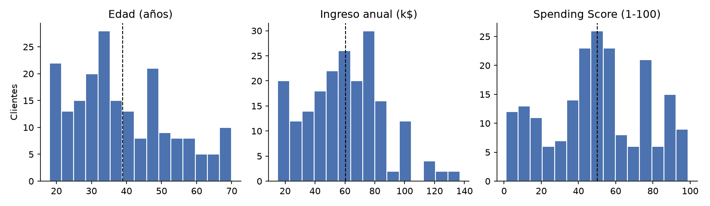

**Lectura:** el ingreso tiene una cola derecha (máximo 137k contra mediana 61.5k). El score cubre todo el rango de 1 a 99 y la edad va de 18 a 70, con la mayoría entre 28 y 49.

---

## 3. Exploración: qué variables segmentan

### 3.1 Relaciones entre variables

| Par | Pearson | Spearman | p-valor (Pearson) | Lectura |
|---|---|---|---|---|
| Edad - Ingreso | -0.012 | 0.020 | 0.86 | Sin relación. |
| Edad - Score | **-0.327** | -0.345 | 2.3e-06 | Los más jóvenes puntúan más alto. Relación moderada y significativa. |
| Ingreso - Score | 0.010 | 0.008 | 0.89 | Sin relación **lineal**. |

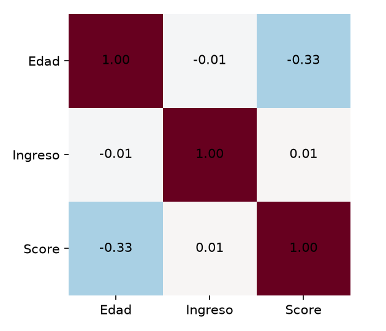

**Punto clave:** que ingreso y score no estén correlacionados **no** significa que no haya estructura. La correlación solo mide relación lineal global. En el gráfico derecho de la figura anterior se ven bloques: un cliente puede tener ingreso alto con score alto o con score bajo. Un coeficiente cercano a cero esconde esos grupos, que es justo lo que un clustering busca.

### 3.2 Edad

| Tramo | Clientes | Score medio | Ingreso medio (k$) |
|---|---|---|---|
| 18-29 | 55 | 58.6 | 52.5 |
| 30-39 | 61 | 61.1 | 70.2 |
| 40-49 | 39 | 34.9 | 63.9 |
| 50-59 | 25 | 34.7 | 58.7 |
| 60+ | 20 | 43.0 | 49.0 |

El score medio baja de ~60 (menores de 40) a ~35 (40-59). La edad sí informa sobre el comportamiento.

### 3.3 Género

| Variable | Media mujeres | Media hombres | p (Welch) | p (Mann-Whitney) |
|---|---|---|---|---|
| Edad | 38.1 | 39.8 | 0.40 | 0.62 |
| Ingreso | 59.3 | 62.2 | 0.43 | 0.41 |
| Score | 51.5 | 48.5 | 0.42 | 0.57 |

No hay diferencias significativas. Agregarlo como variable binaria al clustering solo mete ruido (véase 3.4).

### 3.4 ¿Qué combinación de variables conviene?

Se compararon cuatro conjuntos, todos estandarizados. **Hopkins** mide la tendencia a formar grupos (0.5 = datos al azar, cercano a 1 = muy agrupables). La silueta es la del mejor k de cada conjunto.

| Conjunto | Hopkins | Mejor k (silueta) | Silueta |
|---|---|---|---|
| **A: Ingreso + Score** | 0.698 | **5** | **0.555** |
| B: Edad + Ingreso + Score | 0.694 | 6 | 0.427 |
| C: Género + Edad + Ingreso + Score | 0.739 | 8 | 0.388 |
| D: Edad + Score | 0.695 | 2 | 0.472 |

**Cuidado al leer esta tabla:** las siluetas de espacios con distinta cantidad de dimensiones no son estrictamente comparables, porque en más dimensiones las distancias entre puntos tienden a parecerse. Aun así, la dirección es clara: sumar edad y género **no mejora** la separación y fragmenta la solución en más grupos de menor calidad.

**Decisión:** agrupar con **ingreso y score** (conjunto A). La edad y el género se usan **después**, para describir y validar los segmentos.

---

## 4. Elección del número de grupos

Se corrió K-means con 50 inicios por cada k de 2 a 10 sobre el conjunto A ([tabla](tablas/05_metricas_k_A.csv)).

| k | Inercia | Silueta | Calinski-Harabasz | Davies-Bouldin |
|---|---|---|---|---|
| 2 | 269.7 | 0.321 | 95.7 | 1.267 |
| 3 | 157.7 | 0.467 | 151.3 | 0.717 |
| 4 | 108.9 | 0.494 | 174.6 | 0.710 |
| **5** | **65.6** | **0.555** | 248.6 | **0.572** |
| 6 | 55.1 | 0.540 | 243.1 | 0.655 |
| 7 | 44.9 | 0.528 | 254.6 | 0.715 |
| 8 | 37.1 | 0.457 | 267.9 | 0.758 |
| 9 | 32.4 | 0.457 | 271.2 | 0.755 |
| 10 | 29.1 | 0.449 | 269.3 | 0.755 |

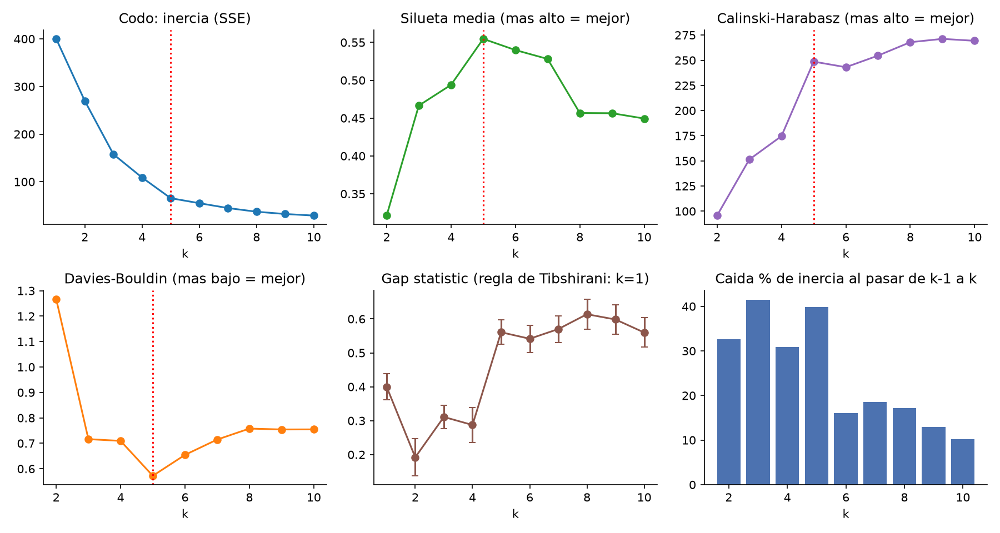

### Lectura criterio por criterio

| Criterio | Qué mide | Resultado | Apoya k = 5 |
|---|---|---|---|
| **Codo** | Cuánto baja la inercia al sumar un grupo | Caídas de 33%, 42%, 31%, **40%** (k = 5) y luego 16%, 19%, 17%... | Sí: la última caída grande es al pasar a 5. |
| **Silueta** | Qué tan cerca está cada punto de su grupo contra el grupo más cercano | Máximo en k = 5 (0.555) | Sí |
| **Davies-Bouldin** | Similitud promedio entre cada grupo y su vecino más parecido (menor = mejor) | Mínimo en k = 5 (0.572) | Sí |
| **Calinski-Harabasz** | Dispersión entre grupos sobre dispersión dentro de grupos | Salto grande hasta k = 5, luego casi plano y creciente | Parcial: no tiene máximo claro. |
| **BIC (mezcla gaussiana)** | Ajuste penalizado por complejidad | Mínimo en k = 5 (1058.7) | Sí |
| **Gap statistic** | Compara la inercia con la de datos uniformes | La regla de Tibshirani elige k = 1; el salto más grande está en k = 5 (0.31 a 0.56) | **No concluyente** |

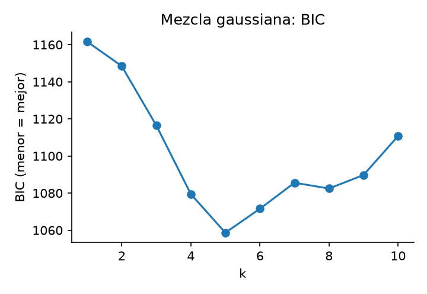

**Sobre la gap statistic:** la referencia es una nube uniforme en el rectángulo que encierra los datos. Como estos datos ya ocupan buena parte del rectángulo, la regla estándar se "rinde" en k = 1. La IA (Claude) no la usa como evidencia a favor ni en contra, y lo declara porque sería engañoso mostrar solo los criterios que coinciden.

### Comparación visual de k = 3, 4, 5 y 6

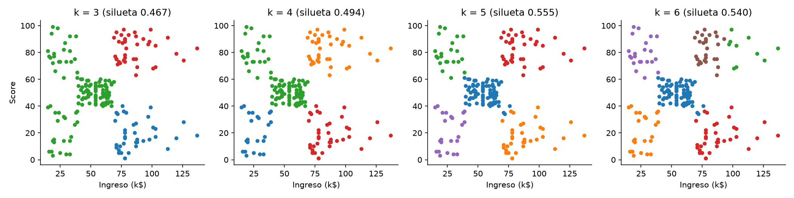

- **k = 3 y k = 4** juntan grupos que visiblemente son distintos (por ejemplo, ingreso alto con score alto y bajo).
- **k = 6** parte el grupo del centro. Su silueta es 0.540 y coincide con k = 5 en ARI = 0.96, es decir, es casi la misma solución con un corte extra de poco valor de negocio.
- **k = 5** produce cinco bloques que se leen directo en el gráfico.

### Otros métodos como contraste

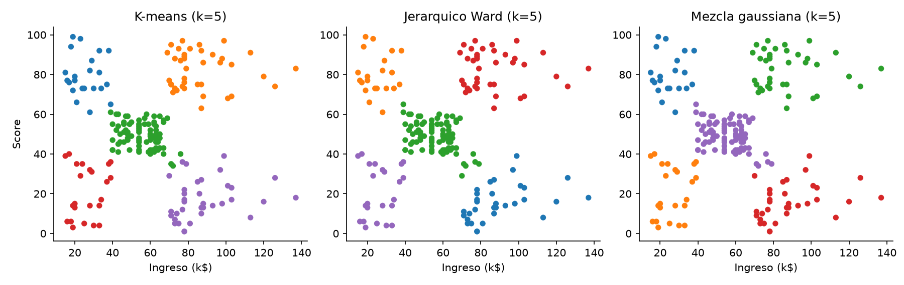

| Método (k = 5) | Silueta | ARI contra K-means |
|---|---|---|
| K-means | 0.555 | (referencia) |
| Jerárquico (Ward) | 0.554 | 0.942 |
| Mezcla gaussiana | 0.554 | 0.956 |

**DBSCAN** (probado con 18 combinaciones de eps y min_samples) da entre 2 y 8 grupos y deja de 8 a 116 clientes como "ruido" según los parámetros. Es muy sensible y no ofrece una solución única, por eso la IA (Claude) no lo usó como método principal.

---

## 5. Modelo final y segmentos

**Modelo:** K-means, k = 5, 100 inicios, semilla 42, sobre ingreso y score estandarizados. Inercia = 65.57, silueta media = 0.555, Davies-Bouldin = 0.572, Calinski-Harabasz = 248.6.

Los segmentos se numeran de menor a mayor ingreso (y de menor a mayor score en caso de empate) para que la numeración sea legible y repetible.

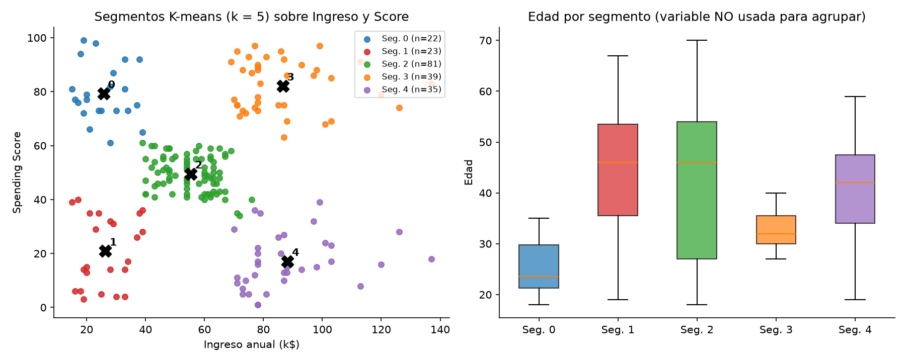

### 5.1 Perfil de cada segmento ([tabla](tablas/08_perfil_segmentos.csv))

| Seg. | n | % | Edad media (rango) | Ingreso medio, k$ (rango) | Score medio (rango) | % mujeres |
|---|---|---|---|---|---|---|
| 0 | 22 | 11.0 | 25.3 (18-35) | 25.7 (15-39) | 79.4 (61-99) | 59.1 |
| 1 | 23 | 11.5 | 45.2 (19-67) | 26.3 (15-39) | 20.9 (3-40) | 60.9 |
| 2 | 81 | 40.5 | 42.7 (18-70) | 55.3 (39-76) | 49.5 (34-61) | 59.3 |
| 3 | 39 | 19.5 | 32.7 (27-40) | 86.5 (69-137) | 82.1 (63-97) | 53.8 |
| 4 | 35 | 17.5 | 41.1 (19-59) | 88.2 (70-137) | 17.1 (1-39) | 45.7 |

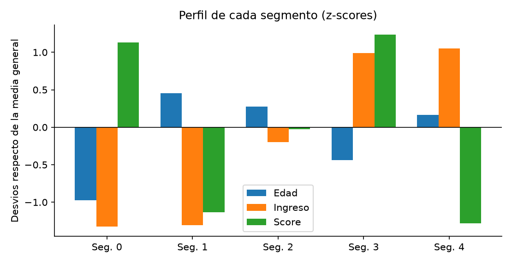

### 5.2 Variables que NO se usaron para agrupar

**Edad:** difiere mucho entre segmentos (Kruskal-Wallis p = 2e-8). Los segmentos 0 (media 25) y 3 (media 33, rango 27-40) son marcadamente jóvenes. El 1 es el de mayor edad media (45). El segmento 2 es el más heterogéneo (18-70, desvío 16.4).

| Seg. | 18-29 | 30-39 | 40-49 | 50-59 | 60+ |
|---|---|---|---|---|---|
| 0 | 16 | 6 | 0 | 0 | 0 |
| 1 | 2 | 6 | 7 | 4 | 4 |
| 2 | 24 | 10 | 18 | 13 | 16 |
| 3 | 8 | 30 | 1 | 0 | 0 |
| 4 | 5 | 9 | 13 | 8 | 0 |

**Género:** distribución similar en todos los segmentos (de 45.7% a 60.9% de mujeres), sin asociación significativa (chi-cuadrado = 2.23, 4 g.l., p = 0.69). No justifica adaptar campañas por género.

### 5.3 Calidad de cada cliente en su grupo

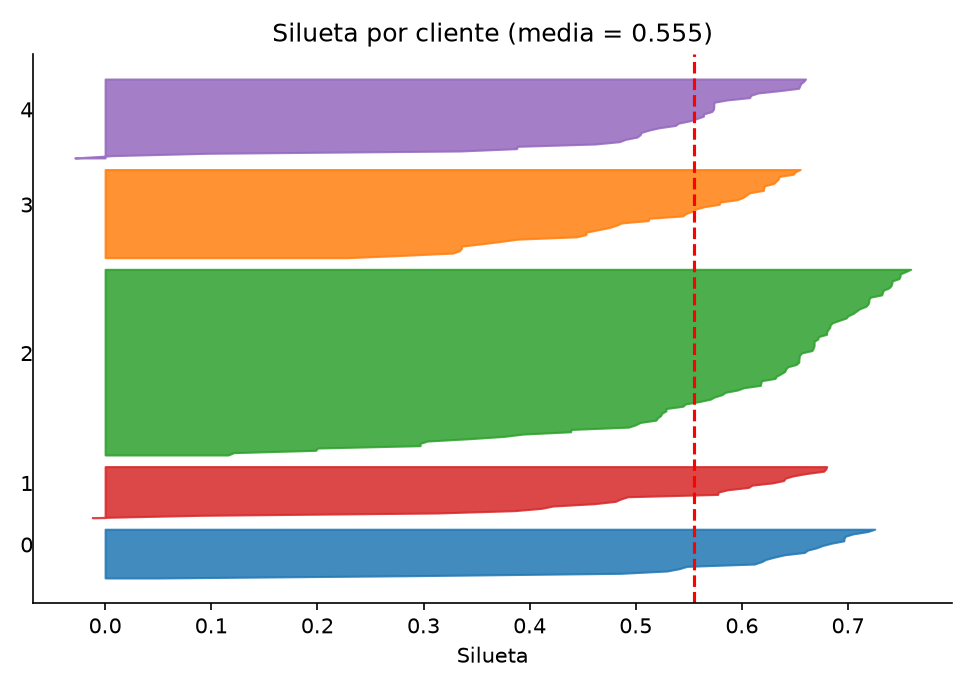

198 de 200 clientes tienen silueta positiva y el promedio es 0.555. Los dos con silueta levemente negativa (-0.03 y -0.01) son el cliente 147 (ingreso 77k, score 36) y el 43 (ingreso 39k, score 36). Los de menor silueta están en las fronteras entre segmentos (por ejemplo, ingreso 70-79k con score 29-36, entre el 4 y el 2), donde la asignación es menos firme.

### 5.4 Peso relativo de cada segmento (indicador ilustrativo)

**Aviso:** el dataset no trae gasto en dinero. Este indicador fue ideado por la IA (Claude) para priorizar, igual a `ingreso × score / 100` sumado por segmento. **No es facturación** y no debe tomarse como tal; solo da un orden de magnitud para decidir dónde empezar.

| Seg. | Clientes | Indicador ingreso × score (suma) | % del total |
|---|---|---|---|
| 0 | 22 | 447.3 | 7.3% |
| 1 | 23 | 129.9 | 2.1% |
| 2 | 81 | 2205.3 | 36.2% |
| 3 | 39 | 2769.6 | **45.5%** |
| 4 | 35 | 541.6 | 8.9% |

Con esta lectura, el segmento 3 (19.5% de los clientes) concentra casi la mitad del indicador, y el 4 es el que tiene más espacio para crecer: mismo nivel de ingreso que el 3 pero con score 17 contra 82.

---

## 6. Acciones de marketing

| Seg. | Frase | Acción concreta | Cómo medir si funcionó |
|---|---|---|---|
| **0** Jóvenes gastadores, ingreso bajo | Compran mucho con poco dinero; edad media 25. | Cuotas sin interés, cupones de monto bajo y promociones en redes sociales. No empujar crédito agresivo: el ingreso es bajo. | Frecuencia de visita y ticket medio, con la mora o devoluciones como señal de alerta. |
| **1** Ahorradores, ingreso bajo | Poco dinero y poco gasto; edad media 45. | No gastar en descuentos masivos. Mails de bajo costo con ofertas de primera necesidad y un cupón de prueba de primera compra. | Tasa de uso del cupón. Si es menor a la del segmento 2, no insistir. |
| **2** Cliente medio | El núcleo: ingreso y gasto moderados, 40% de la base. | Programa de puntos, ofertas de temporada y campaña "sumá un nivel" para subir el ticket de los de score ~50 hacia ~65. | Movimiento de clientes del segmento 2 hacia el 3 (en score). |
| **3** Premium | Ingreso y gasto altos, 27-40 años. | Membresía VIP con acceso anticipado a lanzamientos, personal shopper y eventos privados; mensajes personalizados. Prioridad en retención: perder uno cuesta más. | Retención a 12 meses y gasto por cliente. |
| **4** Potencial dormido | Ingreso alto, gasto bajo (17). | Reactivación: encuesta corta de 3 preguntas para entender el motivo (oferta, horarios, precio, distancia), curaduría de marcas premium y experiencias, invitaciones a eventos. | Prueba A/B: invitar a la mitad y dejar a la otra mitad como control. Medir el aumento de score o visitas. |

**Importante:** todas las acciones son **hipótesis**. El clustering describe quién se parece a quién, no por qué compra cada uno ni qué lo haría comprar más. Cada una se valida con un piloto con grupo de control antes de escalar.

---

## 7. Variante con edad (tres variables)

Si se agrupa con edad, ingreso y score (conjunto B), el mejor k por silueta es 6 (silueta 0.427).

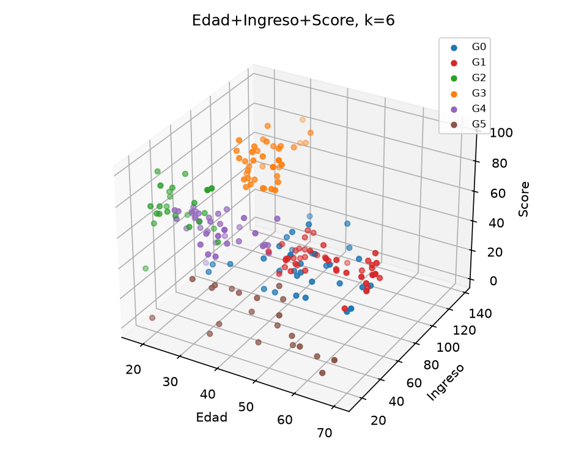

| Grupo | n | Edad | Ingreso | Score |
|---|---|---|---|---|
| 0 | 33 | 41.9 | 88.9 | 17.0 |
| 1 | 45 | 56.3 | 54.3 | 49.1 |
| 2 | 24 | 25.2 | 25.8 | 76.9 |
| 3 | 39 | 32.7 | 86.5 | 82.1 |
| 4 | 38 | 26.7 | 57.6 | 47.8 |
| 5 | 21 | 45.5 | 26.3 | 19.4 |

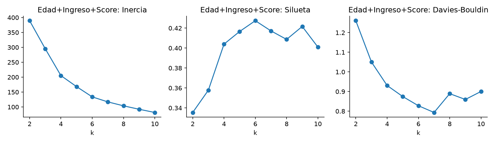

**Qué cambia:** los cinco segmentos originales se reconocen (grupos 0, 2, 3 y 5 equivalen a los segmentos 4, 0, 3 y 1), y el segmento medio se parte en dos por edad (grupo 1 de 56 años y grupo 4 de 27 años). La coincidencia entre ambas soluciones es ARI = 0.69.

**Lectura de la IA (Claude):** es una alternativa válida si el negocio quiere distinguir al cliente medio joven del mayor, pero las métricas de calidad son peores (0.43 contra 0.55), la curva de silueta es casi plana entre k = 5 y 9, y es más difícil de explicar. Para esta entrega se mantiene el conjunto A y se usa la edad como descripción.

---

## 8. Verificación independiente

Para no depender solo de lo que devuelve la librería, la IA (Claude) recalculó los resultados por otros caminos:

| Verificación | Resultado | Conclusión |
|---|---|---|
| K-means implementado a mano (algoritmo de Lloyd con inicialización k-means++, 200 inicios) | Inercia 65.5684 contra 65.5684 de scikit-learn; ARI = 1.0 | Idéntico |
| Silueta calculada a mano (distancias punto a punto) | 0.554657 contra 0.554657 | Idéntico |
| Centroides recalculados con promedios por grupo contra los del modelo | Diferencia máxima 1.4e-14 | Idéntico |
| Estabilidad con 80% de los clientes (200 remuestreos) | ARI medio 0.986; percentil 5 = 0.945; mínimo 0.915 | Estable |
| Otros métodos (Ward y mezcla gaussiana) | ARI 0.942 y 0.956 contra K-means | Coinciden |
| Coincidencia de k = 5 con k = 3, 4 y 6 | ARI 0.54, 0.75 y 0.96 | k = 5 y 6 casi iguales; 3 y 4 son distintos |
| Chequeos de datos (faltantes, duplicados, conteos por género) | 0 faltantes, 0 duplicados; 112 y 88 | Consistente con el archivo |

### Hallazgo que corrige un supuesto

Con **una sola inicialización** por semilla (n_init = 1), solo el **57.5% de 200 semillas** reproduce exactamente la partición final, y la peor tiene ARI = 0.64: K-means cae a veces en mínimos locales. Por eso el modelo final usa **100 inicios** y se queda con el de menor inercia. Si alguien corre K-means una sola vez con otra semilla, puede obtener un resultado peor sin darse cuenta.

---

## 9. Auditoría de criterios

**Pregunta del enunciado:** ¿qué criterio usó la IA para decidir que los grupos tienen sentido? ¿Está de acuerdo? (La parte 9.1 a 9.3 es la valoración de la IA (Claude); la conformidad final es del estudiante.)

### 9.1 Criterios que usó la IA (Claude)

1. **Separación estadística:** silueta (0.555), Davies-Bouldin, BIC y codo apuntan a k = 5.
2. **Estabilidad:** el resultado se repite con submuestras (ARI 0.99) y con otros algoritmos (0.94 a 0.96).
3. **Interpretabilidad:** cada centroide se describe en una frase distinta y se traduce a una acción distinta.
4. **Tamaño:** ningún grupo tiene menos de 11% de los clientes, así que cada uno es accionable.
5. **Coherencia externa:** la edad, que no se usó para agrupar, difiere entre segmentos (p < 0.001); eso sugiere que no son un puro artefacto de las dos variables elegidas.

### 9.2 Dónde la IA (Claude) considera que los criterios son sólidos

- Los criterios 1 a 3 apuntan en la misma dirección y se verificaron por separado.
- Para fines de un TP de segmentación, k = 5 es una respuesta defendible.

### 9.3 Dónde la IA (Claude) ve límites en esos criterios

| Reserva | Por qué importa |
|---|---|
| **Que los datos sean muy limpios es sospechoso, no solo bueno.** | Mall Customers es un dataset didáctico. Una silueta de 0.55 sobre datos de clientes reales sería inusual; el resultado no se extrapola a un negocio real. |
| **La silueta también "premia" el k que cierra con la geometría de las nubes, no el de negocio.** | k = 5 y k = 6 son casi equivalentes (silueta 0.555 contra 0.540, ARI 0.96). Que gane 5 es una diferencia chica. |
| **Ningún criterio es definitivo.** | La gap statistic dio k = 1, el codo es subjetivo y Calinski-Harabasz no tiene máximo claro en 5. La IA (Claude) mostró los que coinciden y también los que no. |
| **"Tiene sentido estadístico" no es "tiene sentido de negocio".** | Los segmentos se leen bien, pero esa es una interpretación de la IA (Claude). Necesita validarse con alguien que conozca el negocio. |
| **El Spending Score es un índice, no conducta observada.** | El enunciado pide "inferir conductas de compra". Lo que se infiere es la conducta que resume ese índice, definido por el centro comercial. No se ve qué compran, cuándo ni cuánto. |
| **Es una foto, no una causa.** | Sin datos en el tiempo no se sabe si un cliente cambia de segmento ni qué lo haría cambiar. |
| **Las etiquetas de segmento son lo único "humano".** | Los nombres ("Premium", "Potencial dormido") los asignó la IA (Claude) mirando los centroides. Otro analista podría nombrarlos distinto. |

### 9.4 Cómo verificar esto vos mismo

- Cambiar la semilla (variable `SEED` del script) y confirmar que los segmentos no cambian.
- Probar k = 4 y k = 6 y decidir si el corte extra agrega algo para el negocio.
- Repetir el clustering en otra herramienta (hoja de cálculo, Data Lab) y comparar centroides.

---

## 10. Limitaciones y próximos pasos

**Limitaciones**
- 200 clientes, una sola foto en el tiempo, y un índice (score) en lugar de gasto real.
- La normalización con z-score asume que ingreso y score pesan igual. Si el negocio considerara que uno importa más, habría que ponderar.
- El indicador de la sección 5.4 es ilustrativo y no está validado con datos de facturación.
- No se verificaron fuentes externas sobre el dataset (origen, definición oficial del score). La referencia usada por la IA (Claude) es la nota de Base/03, que lo registra como recurso didáctico.
- Las reglas prácticas para leer los valores de silueta (por ejemplo, que más de 0.5 indica estructura razonable) son de uso general y la IA (Claude) no las contrastó contra la bibliografía del curso.

**Próximos pasos sugeridos**
1. Probar las acciones con pilotos A/B (grupo de control) en los segmentos 3 y 4, que concentran el potencial.
2. Cruzar los segmentos con gasto real y frecuencia de visita para validar que reflejan conducta.
3. Reentrenar periódicamente y seguir qué clientes cambian de segmento.

---

## Anexo: archivos generados

| Archivo | Contenido |
|---|---|
| [scripts/01_analisis_segmentacion.py](../scripts/01_analisis_segmentacion.py) | Script completo y reproducible |
| [tablas/01_descriptivos.csv](tablas/01_descriptivos.csv) | Estadísticos descriptivos |
| [tablas/02_correlaciones.csv](tablas/02_correlaciones.csv) | Matriz de correlaciones |
| [tablas/04_conjuntos_variables.csv](tablas/04_conjuntos_variables.csv) | Comparación de conjuntos de variables |
| [tablas/05_metricas_k_A.csv](tablas/05_metricas_k_A.csv) | Métricas por k (conjunto A) |
| [tablas/06_metricas_k_B.csv](tablas/06_metricas_k_B.csv) | Métricas por k (conjunto B) |
| [tablas/07_gap_A.csv](tablas/07_gap_A.csv) | Gap statistic |
| [tablas/08_perfil_segmentos.csv](tablas/08_perfil_segmentos.csv) | Perfil de los 5 segmentos |
| [tablas/09_clientes_con_segmento.csv](tablas/09_clientes_con_segmento.csv) | Cada cliente con su segmento |
| [tablas/resultados.json](tablas/resultados.json) | Todos los resultados numéricos |
| `figuras/` | 12 figuras (PNG) referenciadas arriba |
